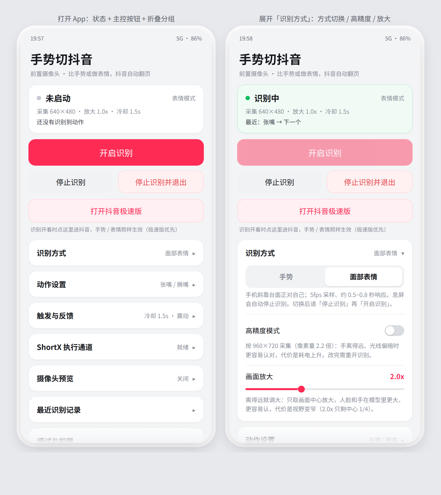

# 手势切抖音（gesture-douyin）

对着手机**前置摄像头比个手势、做个表情**，抖音自动翻到下一个 / 上一个视频。
识别全部在本机完成（MediaPipe），真正的滑动交给 **ShortX** 执行。

[](https://github.com/hwwgo/gesture-douyin/actions/workflows/build-debug.yml)


> **v5.6 更新**：界面重做成「卡片 + 折叠分组」，首屏不再是一整屏说明文字；
> 新增 **停止识别并退出**（停服务 + 关界面一步完成）；去掉系统标题栏，状态栏同色。

---

## 界面



> 上图为按代码里的尺寸与配色绘制的**示意图**（真机渲染用系统默认字体，间距略有差异）。

首屏只有三块东西：

| 区域 | 内容 |
|---|---|
| 状态卡 | 识别中 / 未启动 / 缺少权限（圆点变色）、当前模式、采集分辨率、放大倍数、冷却、最近识别到的动作 |
| 主控 | **开启识别**、**停止识别**（只停识别，界面留着改设置）、**停止识别并退出** |
| 打开抖音 | 极速版优先，没装则开正式版 |

其余设置收进 7 个可折叠分组，折叠时右侧显示当前配置摘要，不展开也知道现在是什么设置：

`识别方式` · `动作设置` · `触发与反馈` · `ShortX 执行通道` · `摄像头预览` · `最近识别记录` · `调试与权限`

---

## 功能

### 识别

| 能力 | 说明 |
|---|---|
| 手势模式 | **数手指**：伸 1/2/3/4/5 根，任意一种可映射为「下一个」或「上一个」；握拳（0 根）不触发 |
| 表情模式 | **8 种动作**任选：张嘴 / 露牙笑 / 龇牙 / 撅嘴 / 鼓腮 / 抬眉 / 眯眼 / 睁大眼 |
| 动作清单 | 表情区直接列出 8 种动作的「怎么做 + 推荐阈值」，不用翻下拉去猜 |
| 阈值可调 | 每个方向一个阈值输入框；切换动作时自动填入该动作的推荐值 |
| 画面放大 | 1.0x ~ 4.0x 数字变焦，手机放得远时把画面中心放大后再识别 |
| 高精度模式 | 采集分辨率 640×480 → 960×720（可选，更准更耗电） |
| 摄像头预览 | 在 App 内直接看识别引擎处理的那一帧，方便调角度 / 光线 / 方向 |
| 防误触 | 动作需保持 0.4~0.5 秒；可设触发冷却；握拳不触发 |

### 操作

| 能力 | 说明 |
|---|---|
| 一键开抖音 | 极速版优先（`…aweme.lite`），没装就开正式版（`…aweme`）；每次点击重新检测 |
| 一键退出 | 停止识别并退出：停掉前台服务、释放相机、关闭界面 |
| 息屏即停 | 屏幕熄灭 = 手动停止识别，亮屏**不会**自动恢复（不会在没人看时占相机、耗电） |
| 事件日志 | App 内环形日志：识别到的动作、实时分数、投递结果，可一键清空 |
| 反馈 | 识别到动作两短震、拉起 ShortX 单击、失败长震（可关） |

### 工程

| 能力 | 说明 |
|---|---|
| 无 Gradle | `aapt2` + `javac` + `d8` + `zipalign` + `apksigner` 手工打包 |
| 界面纯 Java | 无 XML 布局，`MainActivity` 里用代码构建（卡片、分段控件、折叠分组都是工具方法） |
| 依赖自动拉取 | `scripts/fetch-deps.sh` 下载 MediaPipe AAR / JAR 与两个 `.task` 模型（约 35MB，不入库） |
| CI 出包 | GitHub Actions 自动构建 debug APK；推 `v*` tag 自动挂到 Release |

---

## 快速开始（不编译，直接用）

1. 从 [Actions](https://github.com/hwwgo/gesture-douyin/actions) 最新一次成功构建的 **Artifacts** 下载
   `gesture-douyin-debug-*.zip`，或从 [Releases](https://github.com/hwwgo/gesture-douyin/releases) 下载挂好的 APK
2. 安装到手机（**仅 arm64-v8a**，Android 8.0+）
3. 打开 App → 点「开启识别」→ 允许摄像头权限
4. 按下一节配好 **ShortX**，把两条 `shortx://run?id=...` 粘进「ShortX 执行通道」
5. 展开「调试与权限」→ 点「测试「下一个」」，抖音能翻页说明链路通了
6. 回首页点「开启识别」→ 点「打开抖音」→ 开始刷

> debug 包用 debug 密钥签名，**装之前要先卸载手机上已有的正式版**。

---

## ShortX 配置（必读）

翻页不是本 App 做的：App 只负责「识别出动作」，然后拉起 ShortX 的 `shortx://run?id=...`，
由 ShortX 规则执行滑动。所以 ShortX 侧必须先建好两个动作：

| 步骤 | 说明 |
|---|---|
| 1 | 安装 ShortX，并在 **LSPosed 中启用**模块（勾选作用域），确认 ShortX 首页显示已激活 |
| 2 | 在 ShortX 中新建两个「执行滑动」类的动作：一个向上滑（下一个），一个向下滑（上一个） |
| 3 | 每个动作里能拿到一个 **DeepLink id**（形如 `DA-xxxx`），拼成 `shortx://run?id=DA-xxxx` |
| 4 | 回到本 App → 展开「ShortX 执行通道」→ 两条链接分别粘到「下一个」「上一个」 |
| 5 | 给本 App 授予 **「后台弹出界面」或「悬浮窗」** 权限（从后台拉起 ShortX 需要） |

> 链接填错、ShortX 被系统冻结、缺少后台弹出权限，都会表现为「识别到了但不翻页」。
> 排查顺序：先点「测试「下一个」」看能不能翻 → 再看「最近识别记录」里有没有识别到动作。
>
> `docs/ShortX-SETUP.md` 里是早期「挥手 / 摇一摇 / 音量键」规则文件与动作建法，
> 动作本身的滑动手势可以照抄，触发方式按上面的 DeepLink 走即可。

---

## 日常使用

| 场景 | 做法 |
|---|---|
| 手势翻页 | 伸 1~5 根手指，保持 0.4 秒。手抬到脸旁、掌心朝镜头、距离 30~60cm；握拳不触发 |
| 表情翻页 | 做动作保持 0.5 秒；张嘴 / 撅嘴最稳，其余 6 种按需在「动作设置」里换 |
| 认不出来 | 光线补足、手机斜靠正对自己、调低阈值 0.05；离得远先调「画面放大」 |
| 容易误触发 | 调高阈值 0.05，或把冷却调大（两次翻页的最短间隔） |
| 只想改设置 | 点「停止识别」，界面留着；改完再点「开启识别」 |
| 用完了 | 点「停止识别并退出」，服务和界面一起关；直接息屏也会停止识别 |

> 切换「手势 / 表情」、改「高精度模式」后，需要「停止识别」再「开启识别」才生效
> （这些参数决定模型初始化）。

---

## 从源码构建

**环境**：JDK 11+、Android SDK（**build-tools 34+**、**platform android-35**）、`curl`、`unzip`。

```bash
# 1) 指向你的 SDK
export ANDROID_SDK_ROOT=~/Android/Sdk

# 2) 首次：下载 MediaPipe 依赖与模型（约 20MB + 12MB）
bash scripts/fetch-deps.sh

# 3) 构建
bash build.sh            # 正式版：build/gesture-douyin-v5.6.apk
bash build.sh debug      # 调试版：build/debug/gesture-douyin-v5.6-debug.apk
```

产物在 `build/`（已 gitignore）。脚本会自动探测 SDK / build-tools / platform，
也可用 `BT_VERSION`、`PLATFORM_VERSION` 钉死版本（CI 就是这么做的）。

### 调试版与正式版的差别

| 差异 | 正式版 | 调试版 |
|---|---|---|
| `android:debuggable` | 无 | `true`（可 adb 附加调试器） |
| javac / d8 | `d8 --release`（优化、去调试信息） | `javac -g` + `d8 --debug`（保留行号） |
| 事件日志 | 只写 App 内环形缓冲 | 同时输出 logcat：`adb logcat -s GestureDouyin` |
| 签名 | `keys/release.keystore`（首次自动生成） | `keys/debug.keystore`（首次自动生成） |

调试版包名不变、应用名显示为「手势切抖音(调试)」。想用已有密钥直接覆盖安装正式版：

```bash
DEBUG_SIGN_WITH_RELEASE=1 bash build.sh debug
# 或指定自己的密钥
KS_PATH=~/my.keystore KS_ALIAS=app KS_STORE_PASS=*** KS_KEY_PASS=*** bash build.sh debug
```

> **打包必须页对齐。** manifest 里 `extractNativeLibs="false"`，系统直接 mmap APK 内的 `.so`；
> 没对齐的包 `apksigner verify` 全绿、`unzip -t` 也正常，但手机上就是
> `INSTALL_FAILED_INVALID_APK`。`build.sh` 会先试 `zipalign -P 16`（16KB 页），
> 不支持再退 `-p`（4KB），并在签名前用 `zipalign -c` 自检，不过直接退出。

---

## 目录结构

```
.
├── build.sh                     # 构建脚本（aapt2 + javac + d8 + zipalign + apksigner）
├── scripts/fetch-deps.sh        # 下载 MediaPipe 依赖与模型（校验字节数 / zip 完整性）
├── .github/workflows/
│   └── build-debug.yml          # CI：构建 debug APK，打 tag 时挂 Release
├── app/
│   ├── AndroidManifest.xml      # 版本号、权限、<queries> 包可见性
│   ├── src/com/handsfree/douyin/
│   │   ├── MainActivity.java        # 全部界面（卡片 / 折叠分组，纯代码无 XML）
│   │   ├── VisionService.java       # 前台服务：生命周期 / 冷却 / 触发 / 息屏停止
│   │   ├── CameraVisionEngine.java  # Camera2 + MediaPipe（数手指 / 表情 blendshape）
│   │   ├── Trigger.java             # 触发编排（只保留 DeepLink 通道）
│   │   ├── ShortX.java              # shortx:// 拉起（含后台悬浮窗辅助）
│   │   ├── OverlayLaunch.java       # 1x1 不可见 overlay，绕过后台启动限制
│   │   ├── Feedback.java            # 震动 / 提示音
│   │   ├── EventLog.java            # 环形日志（界面展示）
│   │   └── HandsFreeApp.java        # 崩溃日志落盘
│   ├── res/                     # 图标、app_name
│   └── assets/{gesture,face}/   # 模型（fetch-deps.sh 下载，不入库）
├── deps/                        # 第三方二进制（不入库）
└── docs/
    ├── USAGE.md                 # 使用指南（含界面说明、阈值调法、排错）
    ├── BUILD-NOTES.md           # 逐版本技术记录与踩坑
    ├── ShortX-SETUP.md          # ShortX 规则文件与动作建法
    ├── ASSETS.md                # 模型来源与大小
    └── images/ui-overview.png   # 界面示意图
```

---

## 实现要点

- **为什么数手指，而不是用内置手势分类**：MediaPipe 的 7 类手势对角度、距离、光线很挑，
  实测「比耶」很难稳定认出；而 21 个手部关键点的几何判定稳定得多，同一个手势还能表达 5 种含义。
- **拇指要双条件**：只比「指尖到食指根的距离比」时，握拳（拇指搭在手指外）常被误判成 1 根手指；
  叠加 IP 关节夹角 ≥140° 才能正确排除。
- **阈值必须可调**：blendshape 分数个体差异大，同一动作有人 0.7 有人 0.35，固定阈值必然有人不好用。
  日志里会显示「露牙笑 0.38/0.45」这样的实时分数，照着调即可。
- **每帧零分配**：YUV→ARGB 复用 `int[]` 与 Bitmap，放大用预计算映射表。
  5fps 下原来的写法每秒约 6MB 垃圾，GC 抖动会让识别卡顿。
- **包可见性**：Android 11+ 不声明 `<queries><package>` 的话，`getLaunchIntentForPackage()`
  对已安装的抖音也返回 `null`——「打开抖音」按钮永远灰着，且没有异常可抓。
- **界面不用 XML**：`MainActivity` 里 `card() / primaryButton() / addSection()` 一类的工具方法
  统一圆角、间距、配色，改视觉只动常量，不散落在十几份布局文件里。

更多踩坑（依赖链、符号版本、assets 压缩、16KB 页对齐）见 [`docs/BUILD-NOTES.md`](docs/BUILD-NOTES.md)。

---

## 已知限制

- 仅 64 位设备（原生库只有 `arm64-v8a`）
- 依赖 ShortX 执行滑动；本 App 不内置 `input swipe`（那需要 root 或无障碍），也没有无障碍服务
- 息屏会停止识别，亮屏后需回 App 重新开启
- 逆光、戴口罩、光线不足时表情检测率明显下降
- 预览画面部分机型可能上下颠倒——「摄像头预览」里点「方向 +90°」微调（长按恢复自动）

---

## 排错

| 现象 | 原因 / 处理 |
|---|---|
| 安装失败 `INSTALL_FAILED_INVALID_APK` | 旧包签名不同（先卸载）或 `.so` 未页对齐（用仓库的 `build.sh` 构建） |
| 识别到了但不翻页 | ShortX 未启用 / DeepLink 链接填错 / 缺「后台弹出界面」或「悬浮窗」权限 |
| 一直识别不到手势 | 光线太暗、距离太远、阈值太高；先开「摄像头预览」看引擎实际画面 |
| 表情分数上不去 | 逆光或戴口罩；换更明显的动作（张嘴 / 撅嘴），或调低阈值 |
| 老是误触发 | 调高阈值，或把冷却调大；握拳本身不会触发 |
| 服务起不来 / 闪退 | 看「最近识别记录」；崩溃日志落盘在 `Android/data/com.handsfree.douyin/files/crash-*.log` |

---

## 隐私

- 所有识别在本地完成；App **没有申请 INTERNET 权限**，不可能上传画面
- 摄像头帧只在内存中处理，不写入任何文件
- 不需要麦克风（v4.0 起已删除全部语音代码）、不需要 root
- 唯一的外部交互是拉起 `shortx://` 深链

---

## 更新记录

| 版本 | 主要变化 |
|---|---|
| **5.6** | 界面重做：卡片 + 折叠分组、状态卡、分段控件；新增「停止识别并退出」；去掉系统标题栏 |
| 5.5 | 表情动作清单卡片（8 种动作 + 做法 + 推荐阈值）直接摊在界面上 |
| 5.4 | 首页「打开抖音」按钮（极速版优先），补 Android 11+ 包可见性声明 |
| 5.3 | 表情动作扩到 8 种（露牙笑 / 龇牙 / 眯眼 / 睁大眼），修复阈值被 Spinner 初始化覆盖的 bug |
| 5.1 / 5.2 | 画面放大 1.0x~4.0x 数字变焦（中心裁剪 + 映射表，零额外分配） |
| 5.0 | 息屏 = 手动停止识别（相机释放、通知消失，亮屏不自动恢复） |
| 4.0 | 删除全部语音代码，只保留视觉识别 |

逐版本的实现细节与踩坑记录见 [`docs/BUILD-NOTES.md`](docs/BUILD-NOTES.md)。

---

## 上传到 GitHub / 发版

这个目录已经是一个可直接入库的工程：`.gitignore` 已排除 `build/`、`deps/`、`keys/`、
`*.apk` 与两个 `.task` 模型（约 35MB，交给 `fetch-deps.sh` 拉）。

```bash
git add -A
git commit -m "feat(ui): 卡片式分组界面 + 停止识别并退出 (v5.6)"
git push
```

用网页 *Add file → Upload files* 也可以，但**只上传源码**，别把 `build/`、`deps/`、
`keys/` 拖进去。

### 自动构建 debug APK（GitHub Actions）

仓库自带 [`.github/workflows/build-debug.yml`](.github/workflows/build-debug.yml)，推上去就能云端出包：

| 触发 | 结果 |
|---|---|
| push 任意分支 / PR | 构建 debug APK，上传为 artifact（Actions 页面底部下载，保留 30 天） |
| 推 `v*` tag | 额外创建 Release，把 `gesture-douyin-vX.Y-debug.apk` 挂上去 |
| Actions 页手动 *Run workflow* | 同 push |

发版：

```bash
git tag v5.6
git push origin v5.6
```

流程：`checkout` → JDK 17 → 复用 runner 预装 Android SDK（缺 build-tools 35 / platform 35 才补装）
→ 缓存 `deps/`、两个模型与固定 debug 密钥 → `fetch-deps.sh` → `build.sh debug`
→ 用 `aapt2 dump badging` 断言 `application-debuggable` 出现 → 上传产物。

> **不要改用 `android-actions/setup-android@v3`。** 它内部固定执行 `sdkmanager tools`，
> 而 `tools` 包在新版 cmdline-tools 里已被移除，会在第一步就失败。
>
> workflow 用 `BT_VERSION` / `PLATFORM_VERSION` 把版本钉在 35.0.0 / android-35，
> 避免 runner 预装 36.x 时构建行为漂移。首次跑约 3–5 分钟，之后命中缓存约 1 分钟。

---

## 免责声明

仅供个人学习与自用。使用自动化工具操作第三方应用可能违反其服务条款，请自行评估风险；
因使用本软件产生的任何后果由使用者承担。

## 许可

未附带开源许可证。如需转载或分发，请先联系作者。
